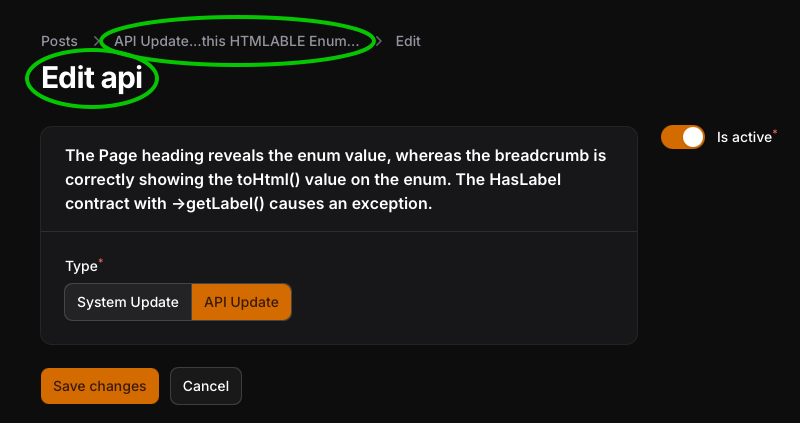

# Install

Clone the project and run migration. Three posts will seed with the migration.
Git history shows the process of each step to recreate.

## The Laravel setup:

### App\Models\Post

```php
class Post extends Model
{
    protected $fillable = [
        'type', 'is_active',
    ];

    protected function casts(): array
    {
        return [
            'type' => PostTypes::class, // The `type` attribute is cast to `PostTypes` enum.
            'is_active' => 'boolean', // This is nothing
        ];
    }
}
```

### App\Enums\PostTypes

See comments:

```php

enum PostTypes: string implements HasLabel, Htmlable
{
    case SYSTEM = 'system';
    case API = 'api';

    /**
     * This enum is cast on the Post->type
     * 
     * @see /admin/posts/1/edit
     * 
     * TypeError
     * vendor/filament/filament/src/Resources/Resource/Concerns/HasLabels.php:107
     * 
     * Filament\Resources\Resource::getRecordTitle(): 
     * Return value must be of type Illuminate\Contracts\Support\Htmlable|string|null, 
     * App\Enums\PostTypes returned
     */

    public function getLabel(): ?string
    {
        return match ($this) {
            self::SYSTEM => 'System Update',
            self::API => 'API Update',
        };
    }

    /**
     * Adding in Htmlable contract resovles the above exception. However, the breadcrumbs 
     * and the page Heading is not consistent. 
     * 
     * @see /admin/posts/1/edit
     * 
     * -- Page Heading: Edit system
     * -- Breadcrumbgs: System Update...this HTMLABLE Enum...
     * 
     * It is expected that page heading is the same as what's shown in the breadcrumb.
     * Page heading is currently showing the enum value, not any label.
     * It is expected that both areas should utilize the getLabel() instead of htmlable.
     * 
     */

    public function toHtml(): string
    {
        return $this->getLabel() .'...this HTMLABLE Enum...';
    }

}

```

## The Filament setup

### App\Filament\Resources\Post\PostResource


```php

class PostResource extends Resource
{
    protected static ?string $model = Post::class;

    protected static ?string $recordTitleAttribute = 'type'; // This is declared

    //...

```


## The Issue

Resource pages to view or modify the resource have the wrong, unexpected heading. 

The Page heading reveals the enum value, whereas the breadcrumb is correctly showing the toHtml() value on the enum. The HasLabel contract with ->getLabel() causes an exception.



#### Breadcrumbs: Displays the enum->toHtml() value

```
    Posts > API Update...this HTMLABLE Enum... > Edit
```

#### Page Heading: Displays the enum->value

```
    Edit system
```

